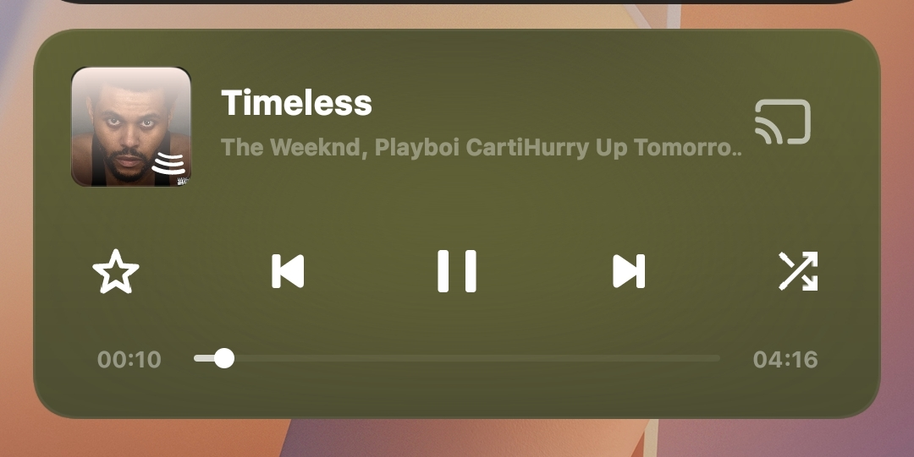
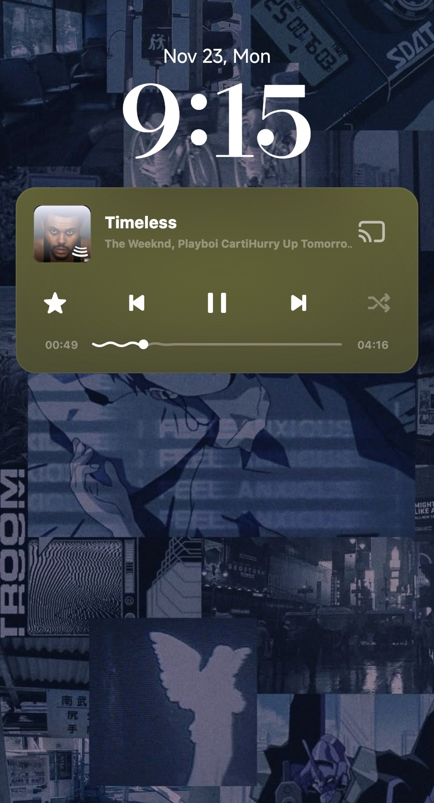
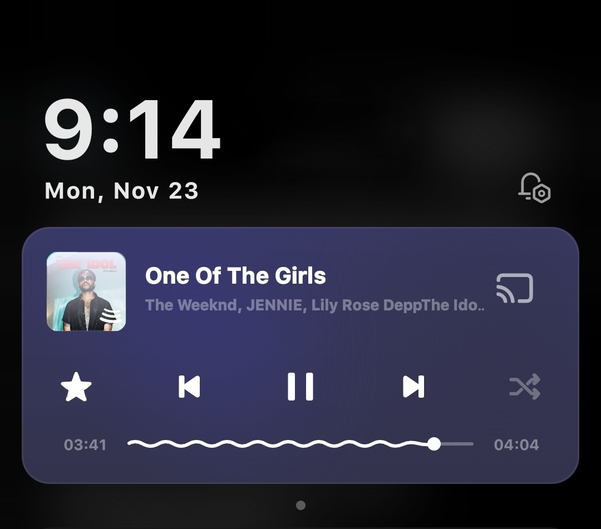
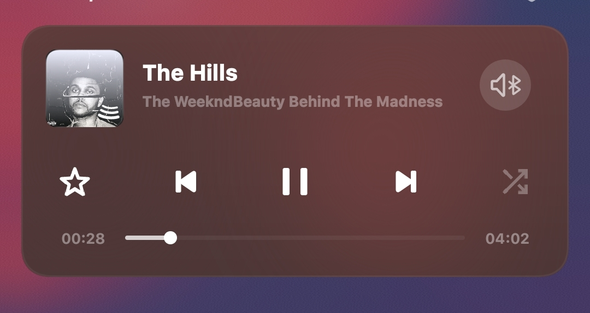
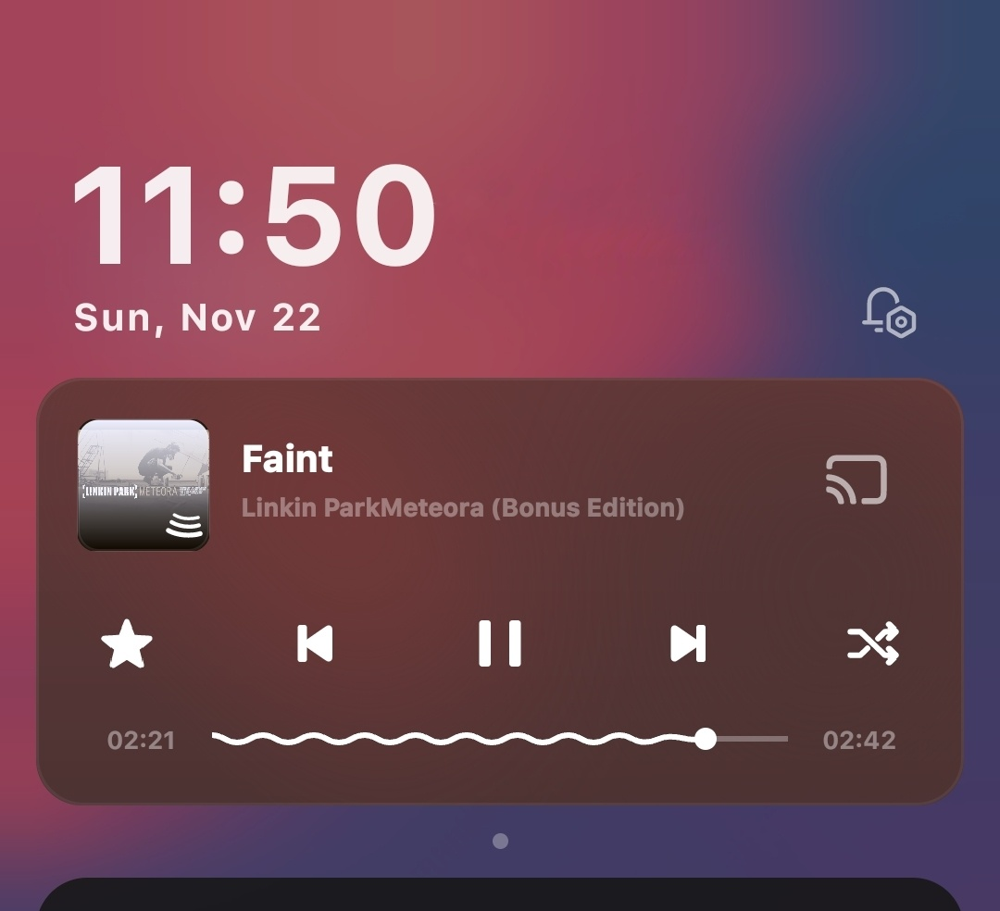

# pixelmm-lsposed

An LSPosed module that gives the HyperOS media player the Pixel-style squiggly progress bar.

**Status:** First release available (`v0.1.0`). Tested on one device and ROM.

## What it does

HyperOS SystemUI still contains Google's `SquigglyProgress` class, but its media card never uses it. This module hooks SystemUI at runtime and does three things:

- Installs that existing class as the media seekbar's progress drawable.
- Turns the wave on only while music is playing, and flattens it when paused or scrubbing.
- Rounds the ends of the track, which would otherwise be cut flat.

Nothing in `/system` is modified, and the module can be switched off at any time.

## Screenshots

### Lock Screen

**Before**



**After**





### Notification Shade

**Before**



**After**



## Tested on

- Redmi Note 11 4G (spes)
- Xiaomi.eu HyperOS 1
- Android 13
- Build: `V816.0.11.0.TGKMIXM`

Verified on the notification shade and lock screen.
Control Center: Not tested. Its media controls are implemented separately in `MiuiSystemUIPlugin.apk`, outside PixelMM's current scope.

Other devices and builds have not been tested and may not work.

## Install

Requires Magisk with Zygisk enabled and LSPosed (Zygisk build).

**Download:** [PixelMM 0.1.0](https://github.com/sabinaya-404/pixelmm-lsposed/releases/tag/v0.1.0)

1. Download and install the APK from the Releases page.
2. Open LSPosed Manager.
3. Enable PixelMM and select System UI in its scope.
4. Reboot your device.
5. Play some music and check the media player.

### Build from source

Requires JDK 17 and the Android SDK (platform 33).

```bash
git clone https://github.com/sabinaya-404/pixelmm-lsposed.git
cd pixelmm-lsposed
./gradlew assembleDebug
```

The debug APK will be available at `app/build/outputs/apk/debug/app-debug.apk`.

## Disabling the module

Turn it off in LSPosed Manager and restart SystemUI. If the manager cannot be reached, run:

```bash
adb uninstall com.sabinaya.pixelmm
```

Then reboot.

## Notes

How the media card works and how the hooks were found is written up in `docs/research/`.

## Credits and license

The squiggly progress bar is Google's design from the Android Open Source Project. This repository does not contain that code. The module uses the copy already shipped in the device's SystemUI, through reflection.

The module's own code is licensed under Apache-2.0 (see `LICENSE`).

This project is not affiliated with Xiaomi or Google, and Pixel is a Google trademark. Use it at your own risk, and back up your boot image before making system changes.